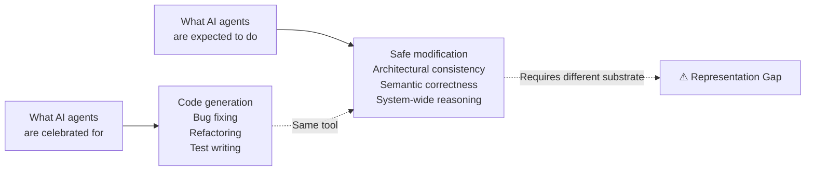
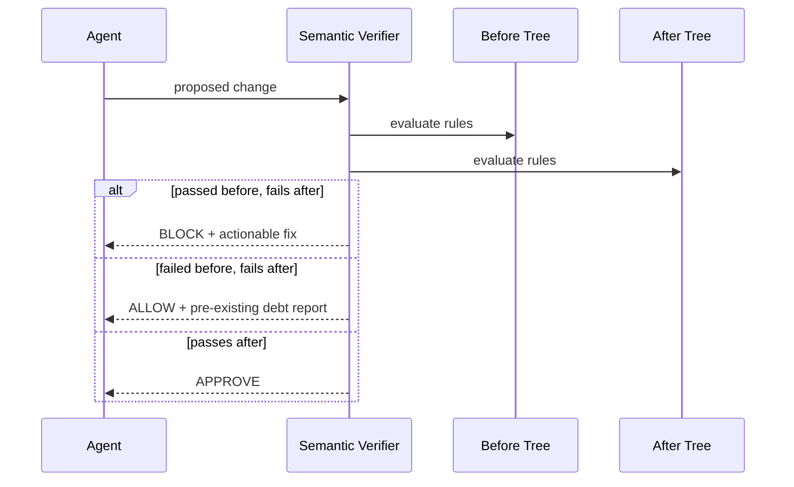
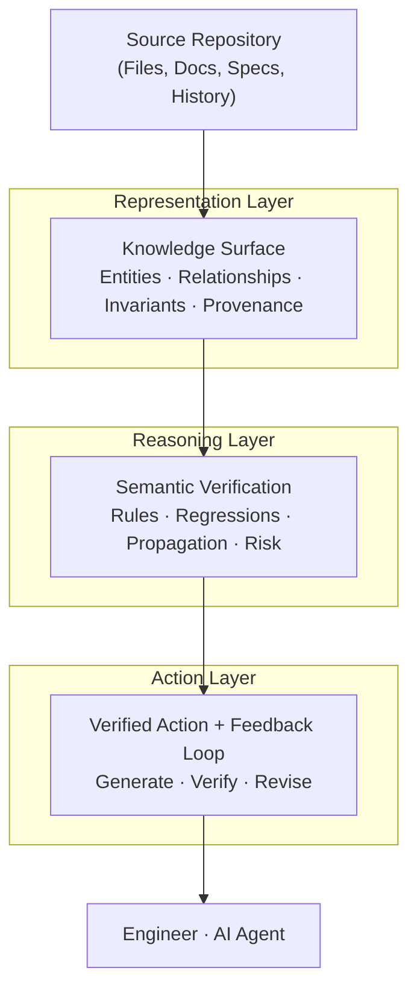

<div align="center">

# The Architecture AI Cannot See

### Why AI coding agents read your software but do not understand it —
### and a measured reference implementation of what a correct solution requires

&nbsp;

[](./LICENSE)
[](https://www.python.org/)
[](#whats-proven)
[](./benchmarks/RESULTS.md)
[](./benchmarks/EXTERNAL.md)
[](./docs/whitepaper.pdf)

&nbsp;

> *"Every production system has two architectures:*
> *the one in the files, and the one that lives nowhere.*
> *We taught AI to read the first.*
> *The second is the one that matters."*

&nbsp;

**Domain** · Software Engineering · AI Systems · Program Comprehension  
**Audience** · Principal Engineers · Architects · Engineering Leaders · Researchers  
**Version** · 1.1 · October 2026

&nbsp;

[Whitepaper](./WHITEPAPER.md) · [PDF](./docs/whitepaper.pdf) · [Verification](./docs/VERIFICATION.md) · [Architecture](./docs/ARCHITECTURE.md) · [Whitepaper → Code](./docs/WHITEPAPER_MAP.md) · [Benchmark](./benchmarks/RESULTS.md) · [Evidence](./benchmarks/EVIDENCE.md)

</div>

---

## Table of Contents

- [TL;DR](#tldr)
- [The Problem](#the-problem)
- [The Idea: The Knowledge Surface](#the-idea-the-knowledge-surface)
- [What Is Actually Built](#what-is-actually-built)
- [Semantic Verification (not scope-touching)](#semantic-verification-not-scope-touching)
- [Measured Evidence](#measured-evidence)
- [Real-World Benchmark](#real-world-benchmark)
- [The Agent Feedback Loop](#the-agent-feedback-loop)
- [Architecture](#architecture)
- [Quick Start](#quick-start)
- [Python API](#python-api)
- [CLI](#cli)
- [What's Proven](#whats-proven)
- [Project Structure](#project-structure)
- [Honest Limits](#honest-limits)
- [Citation](#citation)
- [License](#license)

---

## TL;DR

AI coding agents fail in production not because they are too small, but because they are **reading the wrong thing**. They reason over *files* — a flat sequence of tokens. Software is a *network* — of modules, invariants, capability contracts, and decisions, most of which live nowhere a machine can read.

This repository is a **reference implementation of the fix**, with the part most projects skip: **measured evidence**.

- A **Knowledge Surface** captures both architectures, with honest uncertainty.
- A **semantic verifier** blocks changes only when they *regress* an invariant — not when they merely touch its scope.
- A **benchmark** with labelled violations and safe refactors measures precision, recall, and false-positive rate.
- An **external benchmark** runs against a real public repository (`pallets/itsdangerous`).
- An **agent feedback loop** turns violations into actionable repair instructions and re-verifies.

> The goal is not a better agent. The goal is a better substrate for the agent to reason over.

---

## The Problem



Every senior engineer who deploys these tools into a real codebase notices it within days: the agent fixes one function and breaks two others it never touched; adds a feature that is locally correct but architecturally incompatible; passes every test and violates an invariant no test checks.

This is not a performance problem. It is not a context-length problem. It is a **representation problem**.

| Approach | What it provides | What it misses |
|----------|-----------------|---------------|
| Small context window | Direct neighborhood of a file | Most of the system |
| Large context window | Most of the system's text | The system's *structure* |
| **Knowledge Surface** | The system's structure | Nothing — this is the goal |

> **Context is not comprehension. Comprehension requires structure, not scale.**

---

## The Idea: The Knowledge Surface

Every production system has **two architectures**:

1. **The first architecture** lives in the files — modules, classes, functions, imports, tests. It can be read, cloned, indexed. It is what AI agents receive.
2. **The second architecture** is the network of invariants that must be preserved, the capability contracts never formalized, the layer rules enforced by review culture, the decision history. It lives in no file. It cannot be loaded into a context window.

The Knowledge Surface is the structured, queryable representation of **both** — with **honest uncertainty** as a first-class value, so the system never confuses what it parsed with what it inferred.

---

## What Is Actually Built

| Capability | Where | Status |
|---|---|---|
| Typed entities, relationships, invariants, provenance | `representation/` | ✅ |
| AST extraction with honest `UNKNOWN` for unresolved imports | `extractors/python_ast.py` | ✅ |
| Call graph, dynamic imports (`importlib`, f-strings), framework decorators | `extractors/deep.py` | ✅ |
| **Semantic rule engine** (not scope-touching) | `verification/` | ✅ |
| **Regression-only blocking** (pre-existing debt never blocks) | `verification/engine.py` | ✅ |
| **Behavioural invariants** executed in a subprocess | `verification/rules.py` | ✅ |
| **False-positive control** via allowlist + regression logic | `verification/rules.py` | ✅ |
| **Benchmark** with precision / recall / FPR | `benchmarks/` | ✅ |
| **External benchmark** on a real public repo | `benchmarks/external.py` | ✅ |
| **Agent feedback loop** (propose → verify → feedback → revise) | `agent/` | ✅ |
| **Baseline vs. loop experiment** | `benchmarks/agent_experiment.py` | ✅ |
| Semantic drift detection | `drift/` | ✅ |

---

## Semantic Verification (not scope-touching)

The naive checker is useless in practice: it fires on every refactor that touches an invariant's scope. This engine decides whether a change **actually regresses a rule**.



Rules are evaluated against the **before** and **after** trees. A finding blocks only when it is **introduced**. Legacy debt is recorded, never weaponized against an unrelated change. Safe refactors produce zero findings.

| Rule | What it proves |
|---|---|
| `forbidden_import` | a layer/security boundary is respected |
| `forbidden_call` | `eval`/`exec`/`float`/etc. never enters a scope |
| `require_call` | authorization runs before a sensitive operation, optionally scoped to a class |
| `type_annotation` | public API stays typed |
| `no_mutable_default` | no shared-state footguns |
| `behavioral` | a real Python assertion over the post-change tree |

`require_call` supports `owner` scoping, which real code needs: `SigningAlgorithm.verify_signature` and `Signer.verify_signature` are different functions with the same name in `pallets/itsdangerous`.

---

## Measured Evidence

### Controlled benchmark — 17 labelled scenarios

| Metric | Value |
|---|---|
| True positives | 11 |
| False positives | 0 |
| True negatives | 6 |
| False negatives | 0 |
| Precision | **100%** |
| Recall | **100%** |
| F1 | **100%** |
| False-positive rate | **0%** |

Full breakdown: [`benchmarks/RESULTS.md`](./benchmarks/RESULTS.md).

The scenarios include introduced violations (layer breaks, missing authorization, mutable defaults, float regressions, dynamic-import escapes) and safe refactors (renames, docstrings, added methods) plus a pre-existing-debt case.

### Agent experiment — baseline vs. verification loop

Ground truth is the scenario label, not the verifier's own verdict.

| Metric | Baseline | With loop |
|---|---|---|
| Changes that are actually safe | 6/17 (35%) | **17/17 (100%)** |
| Unsafe changes committed | 11/17 | **0/17** |
| Average verification overhead | 0 ms | ~30 ms |

Full breakdown: [`benchmarks/EVIDENCE.md`](./benchmarks/EVIDENCE.md).

> **Honest note:** the revision in this experiment is a deterministic safe repair, so the experiment measures the loop's ability to *gate and converge*, not an LLM's repair quality. The `LLMAgent` adapter in `agent/llm_adapter.py` plugs in any `complete(prompt) -> str` model for a real experiment.

---

## Real-World Benchmark

`benchmarks/external.py` clones pinned public repositories and runs labelled scenarios against them. It is not overfit to the toy fixtures.

**Targets:** `pallets/itsdangerous` @ `672971d` and `psf/requests` @ `611c616`

| Scenario | Category | Expected | Result |
|---|---|---|---|
| Remove constant-time comparison (itsdangerous) | introduced violation | block | ✅ blocked |
| Add `import pickle` to signer | introduced violation | block | ✅ blocked |
| Add `import pickle` to serializer | introduced violation | block | ✅ blocked |
| Add `import pickle` to requests sessions | introduced violation | block | ✅ blocked |
| Add `import subprocess` to requests sessions | introduced violation | block | ✅ blocked |
| Add `eval` to requests auth | introduced violation | block | ✅ blocked |
| Improve a docstring (×2) | safe refactor | allow | ✅ allowed |
| Rename a local variable / import alias (×2) | safe refactor | allow | ✅ allowed |

| Metric | Value |
|---|---|
| Scenarios | 10 |
| Precision | **100%** |
| Recall | **100%** |
| False-positive rate | **0%** |

Full output: [`benchmarks/EXTERNAL.md`](./benchmarks/EXTERNAL.md). Reproduce: `python benchmarks/external.py`.

---

## The Agent Feedback Loop

```
propose → verify → actionable feedback → revise → verify again
```

```python
from knowledge_surface import FeedbackLoop, ScriptedAgent, SemanticVerifier, RequireCallRule

verifier = SemanticVerifier([
    RequireCallRule("delete-auth", r"^delete_account$", "authorize", before_call="delete"),
])
loop = FeedbackLoop(verifier, max_iterations=3)
result = loop.run("remove account", repo_root, agent)
```

Each rejected attempt produces a machine-readable `FeedbackItem`:

```json
{
  "rule": "delete-auth",
  "file": "auth/service.py",
  "line": 12,
  "problem": "delete_account does not call authorize",
  "evidence": "auth/service.py:12 delete_account does not call authorize",
  "fix": "Call authorize before the protected operation.",
  "blocking": true
}
```

`ScriptedAgent` makes the experiment deterministic. `LLMAgent` (`agent/llm_adapter.py`) adapts any model through a `complete(prompt) -> str` callable.

---

## Architecture



| Layer | Package | Responsibility |
|-------|---------|----------------|
| Representation | `representation/`, `extractors/` | Build the surface; capture the Second Architecture; recover call graph, dynamic imports, framework entry points |
| Reasoning | `verification/`, `reasoning/` | Semantic rules, regression detection, propagation, risk |
| Action | `action/`, `agent/` | Gate changes; feed violations back to an agent |

The key property is the **inversion of the burden of proof**: violations are detected *before* they are committed.

---

## Quick Start

```bash
pip install -e .

# Build a Knowledge Surface
ks build examples/demo_codebase -o ks.json

# Inspect
ks inspect ks.json

# Verify a proposed patch against architectural rules
ks verify benchmarks/fixtures/layered_webapp \
  --patch examples/bad.patch \
  --rules examples/ks-rules.json

# Detect semantic drift
ks build examples/demo_codebase -o before.json
ks build examples/demo_codebase_v2 -o after.json
ks drift before.json after.json
```

The `verify` command exits `1` when the patch regresses an invariant — ready for CI.

---

## Python API

```python
from knowledge_surface import (
    SemanticVerifier, ChangeSet, FileChange, ForbiddenImportRule,
)

rules = [ForbiddenImportRule("layer-route-no-db", r"app/routes/.*\.py$", r"app\.db")]
change = ChangeSet(files=[FileChange(
    path="app/routes/orders.py",
    before=original_source,
    after=modified_source,
)])

report = SemanticVerifier(rules).verify(repo_root, change)
print(report.approved, report.summary())
for f in report.findings:
    print(f.path, f.line, f.message, "->", f.suggestion)
```

---

## CLI

```
ks build <path> [-o out.json] [--name name]   Build a Knowledge Surface
ks inspect <ks.json>                          Stats, confidence, unknowns
ks query <ks.json> <name>                     Find entities by name
ks check <ks.json> <entity-id> [--action]     Evaluate a proposed change
ks verify <path> --patch <diff> --rules <json> Semantic verification (CI gate)
ks drift <before.json> <after.json>           Detect semantic drift
ks report <ks.json>                           Full architectural report
```

---

## What's Proven

36 tests, all passing.

| Test file | What it proves |
|-----------|----------------|
| `tests/test_verification.py` | Semantic rules, regression-only blocking, allowlist, behavioural checks, patch parsing |
| `tests/test_agent_and_benchmark.py` | Feedback loop converges; benchmark meets the quality bar |
| `tests/test_deep_extractors.py` | Call graph, dynamic imports, framework decorators |
| `tests/test_entities.py` | Entities, relationships, honest uncertainty |
| `tests/test_knowledge_surface.py` | Graph reasoning, serialization, unknowns surfaced |
| `tests/test_consistency.py` | Inversion of burden of proof |
| `tests/test_propagation.py` | Blast radius and risk scoring |
| `tests/test_drift.py` | Semantic drift detection |
| `tests/test_whitepaper_claims.py` | Direct proofs of whitepaper claims |
| `tests/test_cli.py` | End-to-end CLI smoke test |

```bash
pytest -q
python benchmarks/runner.py          # controlled benchmark
python benchmarks/external.py        # real public repo
python benchmarks/agent_experiment.py
```

---

## Project Structure

```
.
├── WHITEPAPER.md                 # full whitepaper
├── docs/
│   ├── whitepaper.pdf
│   ├── ARCHITECTURE.md
│   ├── VERIFICATION.md           # semantic verification + limits
│   └── WHITEPAPER_MAP.md         # whitepaper section → code/test
├── src/knowledge_surface/
│   ├── representation/           # entities, surface, invariants
│   ├── extractors/               # AST, call graph, dynamic imports, frameworks
│   ├── verification/             # rules, change model, engine, feedback, config
│   ├── reasoning/                # consistency, propagation, risk
│   ├── action/                   # verified action gating
│   ├── agent/                    # feedback loop, scripted + LLM adapters
│   ├── drift/                    # semantic drift detector
│   └── cli.py
├── benchmarks/
│   ├── fixtures/                 # realistic multi-module projects
│   ├── scenarios.py              # labelled violations + safe refactors
│   ├── runner.py                 # precision / recall / FPR
│   ├── external.py               # real public repo benchmark
│   ├── agent_experiment.py       # baseline vs. loop
│   ├── RESULTS.md · EXTERNAL.md · EVIDENCE.md
├── examples/                     # demo codebases, rules, patch
└── tests/                        # 36 tests
```

---

## Honest Limits

The whitepaper is explicit that this problem is unsolved. So is this implementation.

- **Structural rules are not full data flow.** A violation hidden behind dynamic dispatch may be reported as uncertain rather than proven.
- **Behavioural rules execute code.** They run in a temp dir with a timeout, but they are not a security sandbox. Run them on trusted code.
- **Rules must be declared.** The engine cannot invent an invariant that was never written anywhere. That is the tacit-knowledge problem.
- **The benchmark is controlled.** The 17 scenarios are designed to isolate specific rules. The external benchmark adds real-world signal, but ten scenarios over two repositories is not a proof of general superiority.
- **The agent experiment uses a deterministic repair.** It proves the loop gates and converges; it does not prove an arbitrary LLM will repair well.
- **Python only.** The AST extractors target Python; other languages need new extractors.

---

## Citation

```bibtex
@techreport{architecture-ai-cannot-see-2026,
  title  = {The Architecture AI Cannot See: Why AI coding agents read your
            software but do not understand it, and what a correct solution requires},
  author = {Unknown},
  year   = {2026},
  month  = {July},
  note   = {Version 1.0. Public.}
}
```

---

## License

MIT for the code. Whitepaper text © its author; reproduced here for demonstration and discussion.

---

<div align="center">

*The file is not the software.*  
*The software is the knowledge the file was written to hold.*  
*Until we build systems that understand that distinction,*  
*we are handing AI a shadow and calling it the thing.*

</div>
