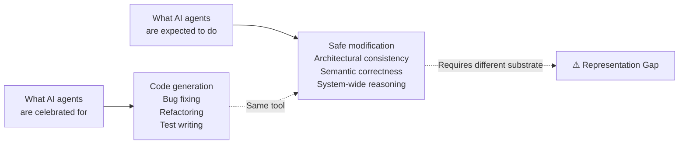
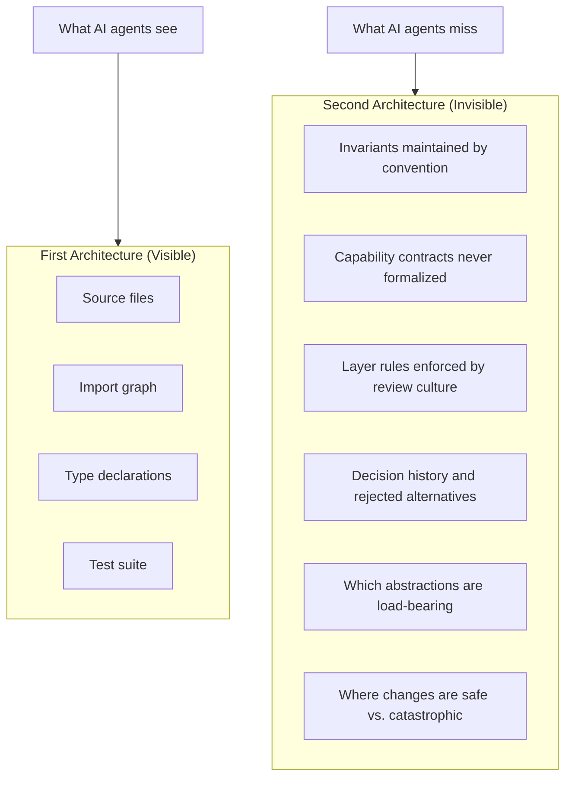
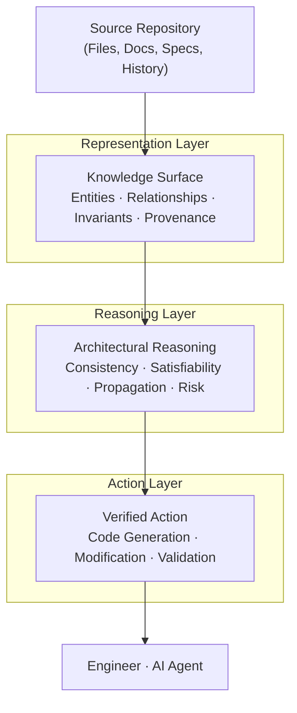

<div align="center">

# The Architecture AI Cannot See

### Why AI coding agents read your software but do not understand it —
### and what a correct solution requires

&nbsp;

[](./LICENSE)
[](https://www.python.org/)
[](#whats-proven)
[](./docs/whitepaper.pdf)
[](https://github.com/dronpancholi/architecture-ai-cannot-see)

&nbsp;

> *"Every production system has two architectures:*
> *the one in the files, and the one that lives nowhere.*
> *We taught AI to read the first.*
> *The second is the one that matters."*

&nbsp;

**Domain** · Software Engineering · AI Systems · Program Comprehension  
**Audience** · Principal Engineers · Architects · Engineering Leaders · Researchers  
**Reading time** · 12–15 minutes  
**Version** · 1.0 · July 2026

&nbsp;

[Read the whitepaper](./WHITEPAPER.md) · [PDF](./docs/whitepaper.pdf) · [Architecture](./docs/ARCHITECTURE.md) · [Whitepaper → Code map](./docs/WHITEPAPER_MAP.md)

</div>

---

## Table of Contents

- [TL;DR](#tldr)
- [The Problem](#the-problem)
- [The Idea: The Knowledge Surface](#the-idea-the-knowledge-surface)
- [Architecture](#architecture)
- [Quick Start](#quick-start)
- [Python API](#python-api)
- [CLI](#cli)
- [What's Proven](#whats-proven)
- [Project Structure](#project-structure)
- [Open Problems](#open-problems)
- [Citation](#citation)
- [License](#license)

---

## TL;DR

AI coding agents fail in production not because they are too small, but because they are **reading the wrong thing**. They reason over *files* — a flat sequence of tokens. Software is a *network* — of modules, invariants, capability contracts, and decisions, most of which live nowhere a machine can read.

This repository is a **reference implementation of the fix**: a structured, queryable representation of *both* architectures of a software system — the written and the unwritten — called the **Knowledge Surface**, plus a Reasoning Layer that evaluates proposed changes before they become commits, and a detector for the **semantic drift** that accumulates when agents work without architectural memory.

> The goal is not a better agent. The goal is a better substrate for the agent to reason over.

---

## The Problem



Every senior engineer who deploys these tools into a real production codebase notices it within days: the agent fixes one function and breaks two others it never touched; adds a feature that is locally correct but architecturally incompatible; passes every test and violates an invariant no test checks.

This is not a performance problem. It is not a context-length problem. It is a **representation problem**.

| Approach | What it provides | What it misses |
|----------|-----------------|---------------|
| Small context window | Direct neighborhood of a file | Most of the system |
| Large context window | Most of the system's text | The system's *structure* |
| **Knowledge Surface** | The system's structure | Nothing — this is the goal |

> **Context is not comprehension. Comprehension requires structure, not scale.**

---

## The Idea: The Knowledge Surface

Every production system has **two architectures**:

1. **The first architecture** lives in the files — modules, classes, functions, imports, tests. It can be read, cloned, indexed. It is what AI agents receive.
2. **The second architecture** is the network of invariants that must be preserved, the capability contracts never formalized, the layer rules enforced by review culture, the decision history. It lives in no file. It cannot be loaded into a context window.

The **Representation Gap** is the structural distance between what is stored in a repository and what is required to safely modify the system.



The Knowledge Surface is the structured, queryable representation of **both** — with **honest uncertainty** as a first-class value, so the system never confuses what it parsed with what it inferred.

---

## Architecture

Three reasoning layers, mirroring the whitepaper's conceptual architecture:



| Layer | Package | Responsibility |
|-------|---------|----------------|
| Representation | `representation/`, `extractors/` | Build the Knowledge Surface from source; capture the Second Architecture |
| Reasoning | `reasoning/` | Consistency checks, propagation (blast radius), risk scoring |
| Action | `action/` | Gate proposed changes; produce verified/unverified verdicts |

The key property is the **inversion of the burden of proof**: architectural violations are detected *before* they are committed, not after, in production.

---

## Quick Start

```bash
# Install
pip install -e .

# Build a Knowledge Surface from a codebase
ks build examples/demo_codebase -o ks.json

# Inspect it
ks inspect ks.json

# Reason about a change (is removing this entity safe?)
ks check ks.json <entity-id> --action remove

# Detect semantic drift between two snapshots
ks build examples/demo_codebase -o before.json
ks build examples/demo_codebase_v2 -o after.json
ks drift before.json after.json

# Full architectural report
ks report ks.json
```

---

## Python API

```python
from knowledge_surface import (
    PythonASTExtractor, InvariantRegistry, ChangeEvaluator, Confidence,
)

# 1. Build the surface from source (First Architecture)
ks = PythonASTExtractor("src/").build()

# 2. Declare the Second Architecture (invariants that live nowhere in code)
reg = InvariantRegistry()
reg.declare(
    name="credit-limit",
    description="an order's total must never exceed the customer's credit limit",
    scope=[order_service_id],
    severity="error",
    confidence=Confidence.KNOWN,
    rationale="enforced by review culture; absent from code",
)
reg.apply(ks)

# 3. Gate a proposed change
ev = ChangeEvaluator(ks)
verdict = ev.evaluate_remove_entity(order_service_id)
print(verdict.approved)        # False
print(verdict.verdict.summary()) # INCONSISTENT: 2 violation(s)
```

---

## CLI

```
ks build <path> [-o out.json] [--name name]   Build a Knowledge Surface
ks inspect <ks.json>                          Stats, confidence, unknowns
ks query <ks.json> <name>                     Find entities by name
ks check <ks.json> <entity-id> [--action]     Evaluate a proposed change
ks drift <before.json> <after.json>           Detect semantic drift
ks report <ks.json>                           Full architectural report
```

---

## What's Proven

23 tests, all passing. Each maps to a whitepaper claim.

| Test file | What it proves |
|-----------|----------------|
| `tests/test_entities.py` | Entities, relationships, honest uncertainty |
| `tests/test_knowledge_surface.py` | Graph reasoning, serialization, unknowns surfaced |
| `tests/test_consistency.py` | Inversion of burden of proof: load-bearing removals blocked |
| `tests/test_propagation.py` | Blast radius and risk scoring |
| `tests/test_drift.py` | Semantic drift detection across sessions |
| `tests/test_whitepaper_claims.py` | Direct proofs of whitepaper claims |
| `tests/test_cli.py` | End-to-end CLI smoke test |

Run: `pytest -q`

---

## Project Structure

```
.
├── WHITEPAPER.md                 # full whitepaper (Markdown)
├── docs/
│   ├── whitepaper.pdf            # original PDF
│   ├── ARCHITECTURE.md           # layer-by-layer design
│   └── WHITEPAPER_MAP.md         # whitepaper section → code/test map
├── src/knowledge_surface/
│   ├── representation/           # entities, surface, invariants
│   ├── extractors/               # python_ast, heuristic invariants
│   ├── reasoning/                # consistency, propagation, risk
│   ├── action/                   # verified action gating
│   ├── drift/                    # semantic drift detector
│   └── cli.py                    # click CLI
├── examples/
│   ├── demo_codebase/            # invariant lives nowhere
│   ├── demo_codebase_v2/         # drifted version
│   └── usage.py                  # end-to-end example
└── tests/                        # 23 tests
```

---

## Open Problems

The whitepaper is honest that these are unsolved. This implementation makes progress on some:

- **Cold start** — `PythonASTExtractor` recovers the First Architecture; the Second Architecture must be declared or heuristically inferred (marked INFERRED).
- **Staleness** — snapshots are immutable; re-build to refresh. Belief revision under source changes is future work.
- **Tacit knowledge** — not recoverable automatically; `InvariantRegistry` is the honest path.
- **Confidence calibration** — every inferred fact carries `Confidence`; never presented as known.
- **Adoption** — partial surfaces produce partial value (the surface is useful even incomplete).

---

## Citation

If you use this work, please cite the whitepaper:

```bibtex
@techreport{architecture-ai-cannot-see-2026,
  title  = {The Architecture AI Cannot See: Why AI coding agents read your
            software but do not understand it, and what a correct solution requires},
  author = {Unknown},
  year   = {2026},
  month  = {July},
  note   = {Version 1.0. Public.}
}
```

---

## License

MIT for the code. Whitepaper text © its author; reproduced here for demonstration and discussion.

---

<div align="center">

*The file is not the software.*  
*The software is the knowledge the file was written to hold.*  
*Until we build systems that understand that distinction,*  
*we are handing AI a shadow and calling it the thing.*

</div>
