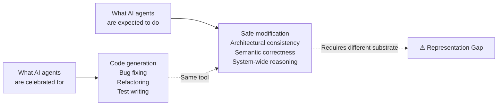
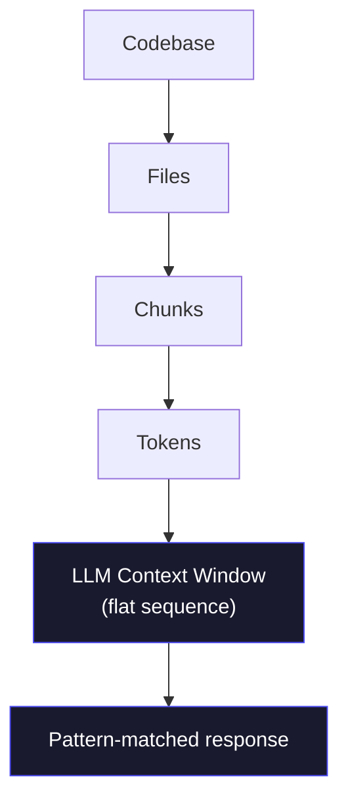
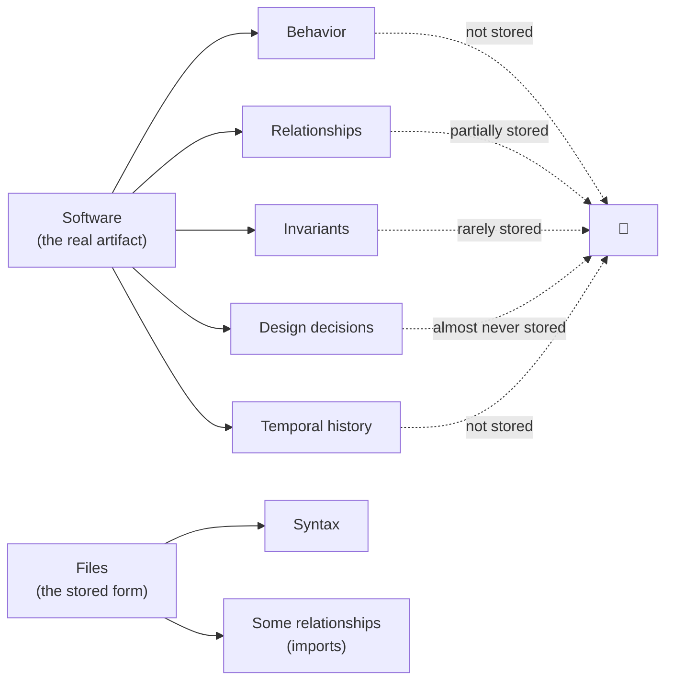
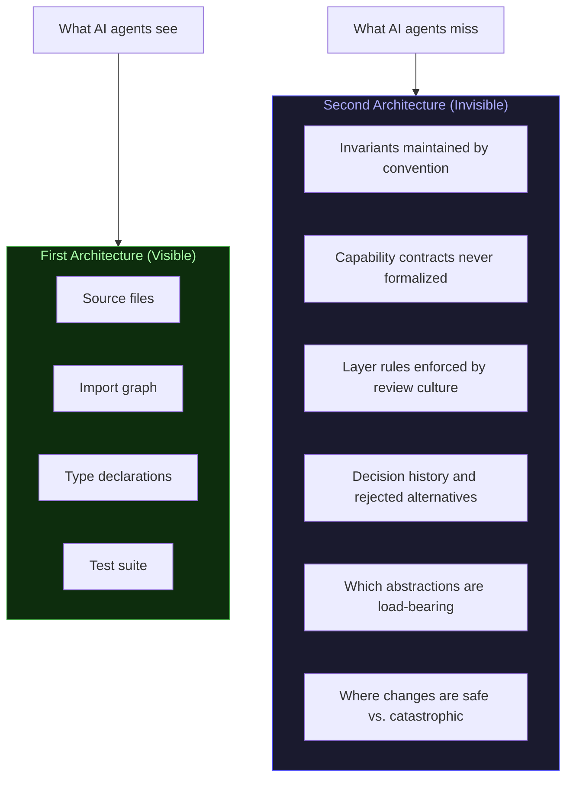
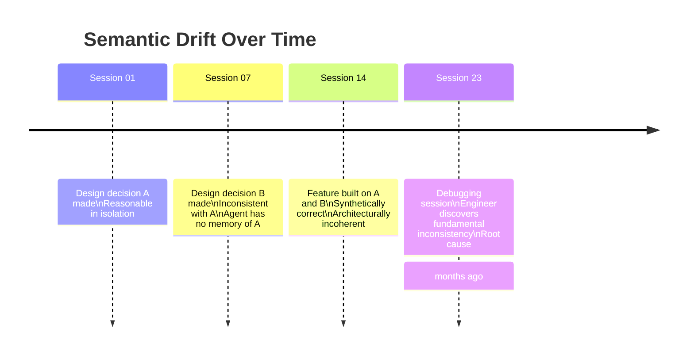
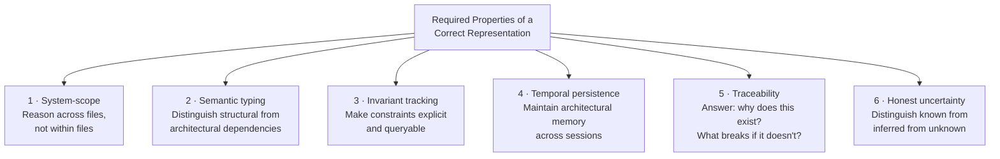
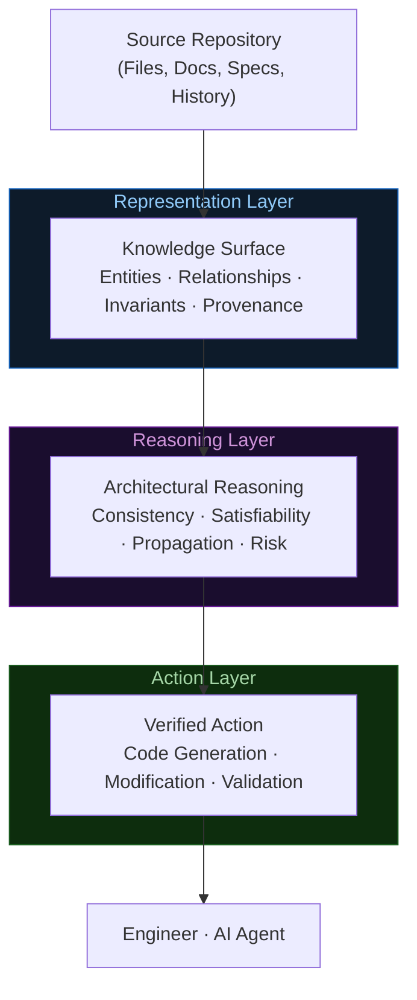
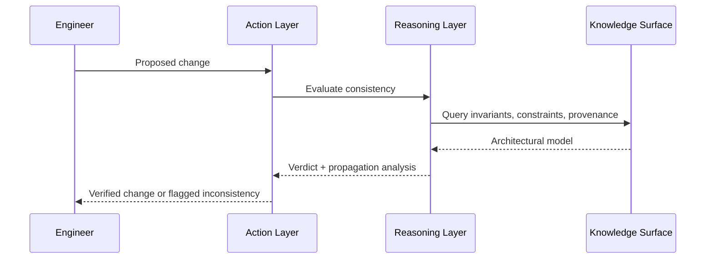
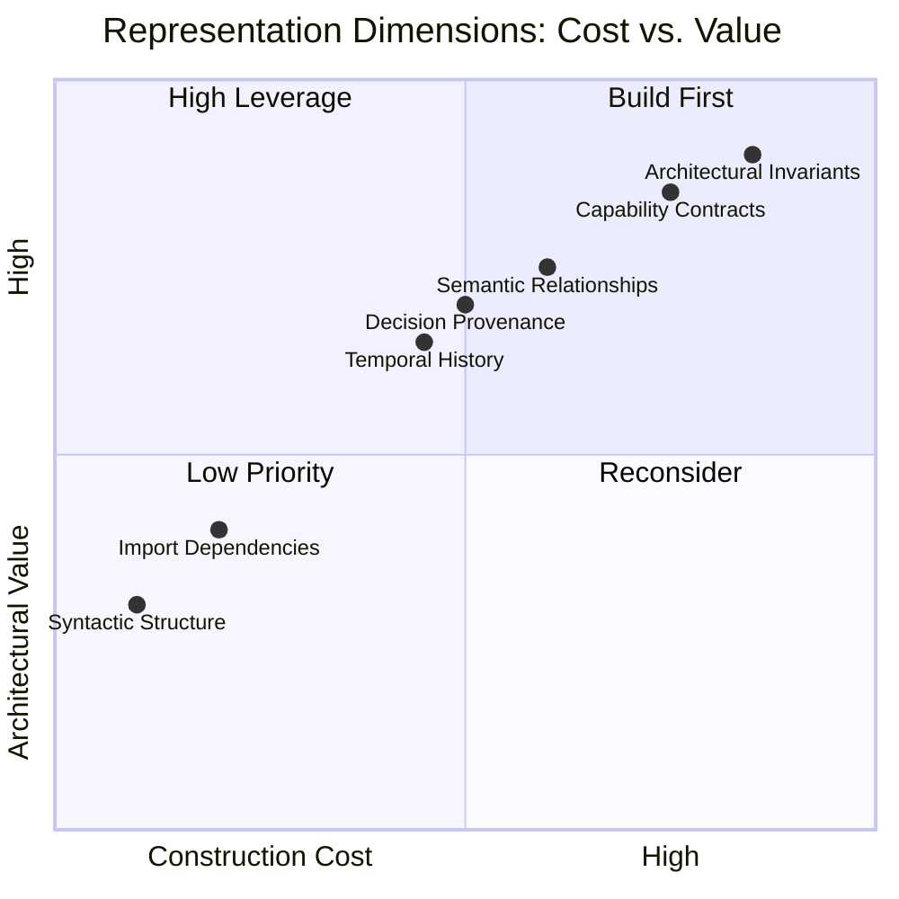
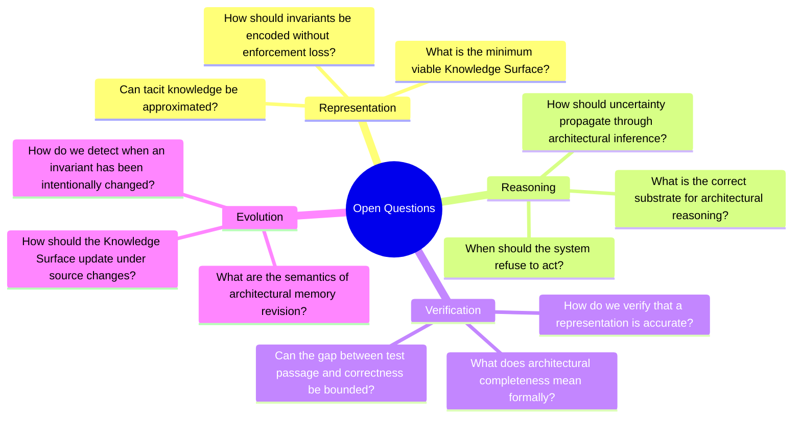

<!--
═══════════════════════════════════════════════════════════════════
  THE ARCHITECTURE AI CANNOT SEE
  Engineering Whitepaper · July 2026
  Classification: Public
═══════════════════════════════════════════════════════════════════
-->

<div align="center">

&nbsp;

&nbsp;

# The Architecture AI Cannot See

### Why AI coding agents read your software but do not understand it —
### and what a correct solution requires

&nbsp;

---

&nbsp;

> *"Every production system has two architectures:*
> *the one in the files, and the one that lives nowhere.*
> *We taught AI to read the first.*
> *The second is the one that matters."*

&nbsp;

---

&nbsp;

**Domain** · Software Engineering · AI Systems · Program Comprehension  
**Audience** · Principal Engineers · Architects · Engineering Leaders · Researchers  
**Reading Time** · 12–15 minutes  
**Version** · 1.0 · July 2026

&nbsp;

</div>

---

&nbsp;

&nbsp;

---

## Before You Read

This document does not announce a product.

It introduces a mental model — one that changes how you think about what AI agents can and cannot do with code, and why the current generation of tools, however impressive, is operating on the wrong representation of software.

If that distinction interests you, read on.

---

&nbsp;

---

&nbsp;

# I. The Capability We Celebrate Is Not the Capability We Need

&nbsp;

> **The question is not whether AI can write code. The question is whether it can understand code it didn't write.**

&nbsp;

AI coding agents are genuinely impressive. They write functions, produce tests, fix bugs, and scaffold entire modules faster than any human team. Benchmark scores improve quarterly. Demo videos are compelling.

And yet every senior engineer who deploys these tools into a real production codebase notices something within days. The agent fixes one function and breaks two others it never touched. It adds a feature that is locally correct but architecturally incompatible. It passes every test and violates an invariant that no test checks. It refactors a module in a way that is technically sound and semantically wrong.

This is not a performance problem. It is not a context length problem. It is not a problem that will be resolved by the next model generation.

It is a representation problem.

&nbsp;



&nbsp;

The gap between what we celebrate and what we need is not a gap of intelligence. It is a gap between what the agent is reasoning over — files — and what the task actually requires — *system understanding*.

These are not the same thing. They are not even close.

&nbsp;

> **Takeaway:** AI coding agents fail not because they are too small, but because they are reading the wrong thing.

---

&nbsp;

---

&nbsp;

# II. Why More Context Doesn't Close This Gap

&nbsp;

> **A larger window onto the wrong representation is still the wrong representation.**

&nbsp;

When engineers observe the failure modes described above, the intuitive response is: give the agent more context. If it's missing information about three related modules, include those modules. If it doesn't see the test suite, add the test suite. If it can't see the whole codebase, expand the context window.

This reasoning is understandable. It is also wrong.

Context windows have grown dramatically. Today's agents can hold hundreds of thousands of tokens simultaneously. This helps for some tasks. It does not resolve the architectural failures. The reason is structural.

&nbsp;



&nbsp;

The context window, regardless of size, receives a *flat sequence of tokens*. Software is not a flat sequence. It is a network. A network of modules that depend on each other in typed ways. A network of invariants that constrain which changes are safe. A network of decisions made at different times by different people for reasons that no longer appear in the code.

You cannot embed a network into a sequence without losing the structure that made the network meaningful.

Consider what a human expert engineer does when approaching an unfamiliar codebase. They do not read files top to bottom. They build a mental graph — identifying modules, understanding their roles, mapping dependencies, inferring constraints, finding the load-bearing abstractions. That graph, accumulated over weeks, is what allows them to reason about safe modification.

No amount of sequential token reading produces that graph. And the context window is, fundamentally, a sequence reader.

&nbsp;

| Approach | What it provides | What it misses |
|----------|-----------------|---------------|
| Small context window | Direct neighborhood of a file | Most of the system |
| Large context window | Most of the system's text | The system's *structure* |
| Structured representation | The system's structure | Nothing — this is the goal |

&nbsp;

The context ceiling is real. It is not a matter of size. It is a matter of what a sequence-based representation is structurally capable of capturing.

&nbsp;

> **Takeaway:** Context is not comprehension. Comprehension requires structure, not scale.

---

&nbsp;

---

&nbsp;

# III. The File Is Not the Software

&nbsp;

> **Files were designed for humans. We are feeding them to machines and calling the result understanding.**

&nbsp;

This is the insight everything else depends on.

The file system is one of computing's oldest and most successful abstractions. It was designed — in the 1960s — to allow humans to organize, navigate, and retrieve stored information. Files have names. Names are human-readable. Files live in directories. Directories form hierarchies. Hierarchies are navigable by humans who understand the naming conventions.

The file system is a *human interface* to stored data. It was never intended to be a machine-native representation of software.

And yet: every AI coding agent today receives software primarily as a collection of files.

&nbsp;



&nbsp;

Look at what files contain: source code, some documentation, some configuration. Look at what software *is*: a precisely specified set of behaviors, maintained by a network of invariants, produced by a sequence of decisions, constrained by a set of architectural commitments. Files contain a fraction of this. The fraction that was easy to write down.

The rest — the invariants maintained by convention, the architectural rules enforced by review culture, the design decisions whose reasoning was never committed to any file — does not live anywhere a machine can read.

**This is not a storage failure.** It is a representation failure. We optimized software storage for human navigation. We built version control for human diffing. We structured codebases for human comprehension.

Now we have handed those same artifacts to machines and asked them to understand the software. The machines are doing the best they can with what they have been given. What they have been given is incomplete by design.

&nbsp;

> **Coined term: The Representation Gap** — the structural distance between what is stored in a software repository and what is required to safely modify the system it represents.

&nbsp;

> **Takeaway:** The file is not the software. It is a human-readable projection of the software onto a medium optimized for human use.

---

&nbsp;

---

&nbsp;

# IV. The Architecture That Lives Nowhere

&nbsp;

> **The knowledge that makes software understandable is the knowledge that isn't written down.**

&nbsp;

Every production software system of meaningful age has two architectures.

**The first architecture** lives in the files. It is the modules, classes, functions, imports, and explicit tests. It can be read, cloned, and indexed. It is what static analysis tools operate on. It is what AI agents receive.

**The second architecture** is different. It is the network of invariants that must be preserved for the system to behave correctly. The capability contracts between modules that were never formalized. The layer rules that exist by convention. The decision history — what was tried, why it was rejected, what constraint the current approach was selected to satisfy. The places in the codebase that are considered stable versus the places that are actively evolving. The modules where a change is safe and the modules where a change cascades through eleven other systems.

This second architecture is what experienced engineers know. Junior engineers spend their first year learning it. When a senior engineer leaves a team, this is what is lost.

It lives in no file. It cannot be retrieved by a search engine. It cannot be loaded into a context window. It cannot be cloned or version-controlled.

&nbsp;



&nbsp;

The tragedy of the current moment is that the parts of software that make it comprehensible — that make it possible to modify safely, to extend confidently, to maintain sustainably — are precisely the parts that AI agents cannot see.

This produces a specific failure mode. An agent operating on the first architecture alone will generate code that is locally correct: syntactically valid, passing tests, lint-compliant. But local correctness does not imply architectural correctness. A change can pass every automated check and still violate an invariant that everyone on the team knows must be preserved.

The agent did not act in bad faith. It acted on the information it had. The information it had was incomplete.

&nbsp;

> **Coined term: The Second Architecture** — the system of invariants, contracts, decisions, and constraints that defines what modifications are safe, but is never stored in any machine-readable artifact.

&nbsp;

> **Coined term: Architectural Blindness** — the inability of file-based reasoning systems to perceive or reason about the Second Architecture.

&nbsp;

> **Takeaway:** The most valuable knowledge in a software system is the knowledge that isn't in the files.

---

&nbsp;

---

&nbsp;

# V. Semantic Drift: How AI Makes Codebases Incoherent

&nbsp;

> **The agent makes every change correctly. The codebase becomes wrong.**

&nbsp;

There is a failure mode unique to AI-assisted development that has no clean name yet. We call it **semantic drift**.

It works like this.

An engineer uses an AI agent across many sessions to build and evolve a system. In session one, the agent makes a design decision — an entity is represented in a particular way, a boundary is drawn at a particular point. The decision is reasonable.

In session seven, the agent faces a similar problem. It has no memory of session one. It makes a different design decision — reasonable in isolation, but inconsistent with what was established earlier.

In session fourteen, the agent is asked to add a feature. It reads the relevant files. The relevant files reflect both the session-one and session-seven decisions. They are inconsistent. The agent synthesizes code that attempts to satisfy both, producing something that is syntactically valid and semantically incoherent.

Tests pass. The system continues to function. The incoherence accumulates.

&nbsp;



&nbsp;

Semantic drift is not a language model failure. It is an architectural memory failure.

A human engineer working continuously on a system accumulates understanding of prior decisions. They recognize inconsistency when they see it. They raise it. They resolve it. An AI agent with no persistent model of the system makes locally correct decisions with no awareness of the decisions that preceded them.

The result is not wrong code. It is worse than wrong code. Wrong code fails fast. Semantically drifted code works — until a system-level interaction makes the incoherence visible, usually in production, usually at the worst moment.

&nbsp;

> **Coined term: Semantic Drift** — the gradual accumulation of architectural incoherence in AI-assisted codebases, resulting from locally correct decisions made without awareness of the architectural model they contradict.

&nbsp;

> **Takeaway:** Without architectural memory, every AI-assisted session is the first. The codebase pays the price.

---

&nbsp;

---

&nbsp;

# VI. What a Correct Solution Must Provide

&nbsp;

> **The goal is not a better agent. The goal is a better substrate for the agent to reason over.**

&nbsp;

If the root cause of AI architectural failures is a representation problem, then the solution is a representation solution. Not a better model. Not a longer context window. Not smarter retrieval heuristics.

A qualitatively different representation of software — one that captures both architectures.

Here are the properties such a representation must have. These are engineering requirements, not product descriptions.

&nbsp;



&nbsp;

**System-scope** means entities are the unit of reasoning, not files. A function, a module, a capability, a constraint — these are first-class entities with properties and relationships that span file boundaries.

**Semantic typing** means not all dependencies are equivalent. An import is not the same as a capability requirement. A call is not the same as an invariant dependency. The representation must make these distinctions explicit.

**Invariant tracking** means the Second Architecture is not merely inferred at query time — it is maintained as a living artifact, updated as the system evolves.

**Temporal persistence** means the architectural model survives across sessions. A decision made in session one is visible in session fourteen. Drift is detectable before it accumulates.

**Traceability** means every entity in the system has a provenance chain. Why does it exist? What decision created it? What constraint does it satisfy? What would break if it were removed?

**Honest uncertainty** means the representation is explicit about what it does not know, and surfaces that uncertainty to the reasoning layer rather than concealing it behind false confidence.

&nbsp;

No current AI coding tool provides all six properties. Most provide zero.

&nbsp;

> **Takeaway:** The correct solution is not a smarter agent. It is a richer substrate. Build the representation, and the reasoning follows.

---

&nbsp;

---

&nbsp;

# VII. A Conceptual Architecture

&nbsp;

> **Software needs an intermediate representation the way compilers need IRs.**

&nbsp;

This analogy is not decorative. It is precise.

Compilers do not transform source code directly into machine code. Every serious compiler infrastructure inserts an intermediate representation between the two — a structured artifact that captures the semantic intent of the source in a form that enables optimization, analysis, and transformation that neither the source nor the binary alone permits.

The intermediate representation is what makes a compiler powerful. It is the substrate on which the interesting work happens.

Software repositories need the same thing. Not for compilation, but for comprehension and safe modification.

We describe this conceptually as three layers. These are not product layers. They are reasoning layers — the logical separation of concerns that any correct solution must respect.

&nbsp;



&nbsp;

**The Representation Layer** takes the full source repository — source files, documentation, architectural notes, history — and produces a structured knowledge surface. Entities are identified. Relationships are typed. Invariants are captured. Provenance is recorded.

The Representation Layer does not make decisions. It makes the system legible to reasoning.

**The Reasoning Layer** answers questions about proposed changes: Is this modification consistent with the invariant model? Does this new module satisfy the capability requirements of its dependents? Does this change propagate effects that require further changes elsewhere? What is the risk surface of this action?

The Reasoning Layer does not generate code. It evaluates code.

**The Action Layer** is where AI-assisted generation and modification occur. Crucially, the Action Layer operates under the constraint of the Reasoning Layer's output. An action flagged as architecturally inconsistent is surfaced to the engineer before it becomes a commit.

&nbsp;



&nbsp;

The key property of this architecture is the **inversion of the burden of proof**. In current workflows, architectural violations are discovered after they are committed, often in production. In this architecture, the Representation Layer creates the conditions for violations to be detected before they are committed.

The agent changes. The architecture stays.

&nbsp;

> **Coined term: Knowledge Surface** — the structured, queryable representation of both architectures of a software system: the written and the unwritten, the explicit and the inferred.

&nbsp;

> **Takeaway:** Give AI a better substrate, not better prompts. The substrate is what determines what the agent can understand.

---

&nbsp;

---

&nbsp;

# VIII. What Makes This Hard

&nbsp;

> **The difficulty is not technical. It is epistemological.**

&nbsp;

Intellectual honesty is not a footnote. This chapter exists because the trade-offs are real, the unsolved problems are genuinely hard, and anyone who presents this problem as essentially solved is wrong.

&nbsp;



&nbsp;

**The Cold Start Problem.** The Knowledge Surface is most valuable for systems that already exist with years of implicit architectural decisions. These are precisely the systems for which the surface is hardest to construct. Recovering architectural intent from legacy code is an inference problem, not a reading problem. Inference at scale is hard.

**The Staleness Problem.** Software evolves continuously. A representation built today may be inaccurate tomorrow. The update semantics for an architectural model are non-trivial: when a source change occurs, what model elements should update, which should be flagged as potentially inconsistent, and which should remain unchanged? This is not a database synchronization problem. It is a belief revision problem.

**The Tacit Knowledge Problem.** Some architectural constraints cannot be formalized. "We don't do it that way" is not encodable. The most important rules in some teams are the most implicit. Any structured representation will be incomplete. The question is whether a *useful* representation can be built from what is recoverable.

**The Confidence Calibration Problem.** A representation that presents inferred relationships with the same certainty as parsed ones is dangerous. A system with architectural blindness is bad. A system with false architectural confidence is worse. Uncertainty must be a first-class value in the representation, not an afterthought.

**The Adoption Problem.** Even a technically correct solution must be adoptable. A system that requires complete representation before providing any value will not be adopted. Incremental value — where partial adoption produces partial improvement — is a prerequisite for real-world deployment.

&nbsp;

> **Takeaway:** The open problems are genuine. The hardest one is not how to build the representation. It is how to know when you have built it correctly.

---

&nbsp;

---

&nbsp;

# IX. The Questions That Matter

&nbsp;

> **We do not close with answers. We close by sharpening the questions.**

&nbsp;

The following are not rhetorical. They are open research and engineering problems. The quality of the solutions that will be built in the next five years depends on how seriously the field takes them.

&nbsp;



&nbsp;

**Can software have an intermediate representation?**
Compilers use IRs to decouple source language from target architecture. Is there an analogous artifact for software repositories — a structured representation that decouples the source (files) from the reasoning target (architectural intent)? What would it mean for such a representation to be *correct*?

**What should an agent refuse to do?**
A system with genuine architectural understanding will sometimes determine that a proposed change is inconsistent with the architectural model. What should happen then? Refusal is safe but unhelpful. Proceeding is helpful but unsafe. The correct policy is a hard design question, and the threshold should probably be configurable.

**Is tacit knowledge recoverable at scale?**
A significant fraction of the Second Architecture exists only in team memory. Can it be surfaced through analysis of code review history, commit messages, documentation, and behavioral patterns? What precision and recall can be achieved? When does low-recall knowledge recovery become worse than no recovery?

**How do we know when the representation is wrong?**
A false architectural model is dangerous. A system that confidently reports that a change is safe when it is not is worse than a system that reports uncertainty. What mechanisms allow the Knowledge Surface to detect its own inaccuracies and surface them explicitly?

**What does architectural correctness mean formally?**
We have formal models for type correctness, for memory safety, for concurrency safety. We do not have a formal model for architectural correctness. Building one is a research problem that nobody has solved. Solving it would be a significant contribution.

&nbsp;

---

&nbsp;

---

&nbsp;

# Closing

&nbsp;

There is a version of the future where AI dramatically accelerates software development without making software less comprehensible. Where systems assist not just with code production but with architectural coherence. Where the accumulated knowledge of a team — the Second Architecture, the invariants, the decisions — is captured, maintained, and made available to every agent and every engineer, across every session.

We are not in that future yet.

We are in a transition period where AI has made producing code nearly trivial, but understanding code has gotten harder. Where the ratio between lines added and lines understood is widening. Where the Second Architecture is accumulating faster than teams can capture it, and AI agents are operating in its absence.

The tools to address this exist in research. The theoretical foundations are partly laid. The engineering problems are genuinely hard.

What is missing is not capability. What is missing is the conviction that the representation layer deserves the same quality of engineering attention that has been given to the generation layer.

---

&nbsp;

> *The file is not the software.*
> *The software is the knowledge the file was written to hold.*
> *Until we build systems that understand that distinction,*
> *we are handing AI a shadow and calling it the thing.*

&nbsp;

---

&nbsp;

---

&nbsp;

## Appendix: Title Generation Log

*25 candidates evaluated before final selection.*

| Candidate Title | Verdict |
|-----------------|---------|
| The Missing Layer | Too generic |
| What AI Cannot Read | Accurate, underpowered |
| The File Illusion | Strong, too abstract |
| Context Is Not Comprehension | Strong thesis, weak as title |
| The Architecture in the Air | Poetic, imprecise |
| Software's Shadow Self | Too literary |
| The Second Codebase | Good, slightly misleading |
| The Half That Lives Nowhere | Vivid, informal |
| Why AI Breaks Your Invariants | Accurate, too specific |
| The Comprehension Gap | Clear, unmemorable |
| What We Stored vs. What We Meant | Too conversational |
| Files Are Lies We Tell Machines | Strong voice, too provocative |
| The Representation Gap | Technical, clear |
| Intelligence Without Architecture | Precise, abstract |
| The Knowledge That Lives Nowhere | Evocative, unclear |
| The Engineering Blind Spot | Too soft |
| The Invisible Architecture | Almost — slightly used |
| Beyond the File System | Too broad |
| Software Is Compressed Knowledge | Interesting, unfocused |
| The Architecture AI Cannot See | **Selected** — specific, evocative, exact |
| Reading the Score, Missing the Music | Metaphor works, too abstract |
| The Representation Problem | Correct, clinical |
| Stored Wrong, Read Wrong | Punchy, ambiguous |
| What Files Cannot Hold | Accurate, forgettable |
| The Missing Representation | Close second |

&nbsp;

---

&nbsp;

## About This Document

This whitepaper presents a problem framing and a set of design requirements — not a specific implementation. Internal representations, algorithms, compiler passes, graph schemas, traversal strategies, indexing methods, and proprietary system architectures are deliberately omitted. The purpose is to establish a mental model, not to disclose a system.

The ideas here are shared because the problem deserves more serious attention than it receives. Disagreement is welcome. Better framings are welcome. Solutions are welcome.

**To connect:** LinkedIn · Direct message

---

*Reproduction of this document's problem framing and design principles for non-commercial academic or technical discussion is permitted. Commercial reproduction requires written permission.*

---

&nbsp;

```
─────────────────────────────────────────────────────────────────
The file is not the software.
─────────────────────────────────────────────────────────────────
```
